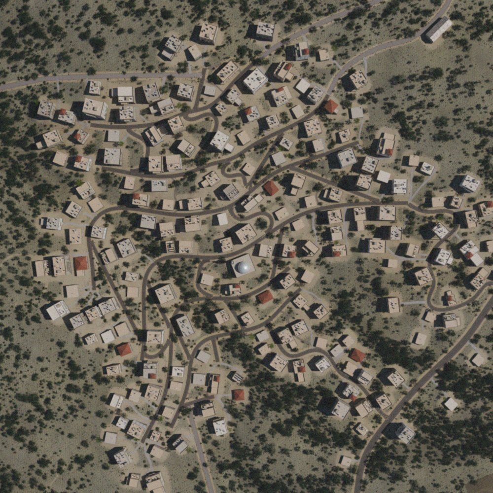

# Synthetic aerial change-detection generator (Blender 5.2 + Python)

Photorealistic, reproducible aerial scenes of Middle-Eastern landscapes (rural Galilee first, Negev later), built from real elevation data and your Fab/Megascans assets, with pixel-exact labels. Scenes are edited through a JSON spec to produce T1/T2 change-detection pairs.

- Design: [docs/ARCHITECTURE.md](docs/ARCHITECTURE.md)
- Hard-won lessons: [docs/LESSONS.md](docs/LESSONS.md)
- Step reports: [docs/steps/](docs/steps/)

## Example output

Synthetic hillside village, seed 1, rendered from directly overhead in Blender.



The scene planner reported 195 buildings, 29 road segments, 85 access paths, and 179 trees. All buildings had access paths. One road exceeded the slope threshold. This example shows a single generated scene.

## Where things live

| What | Where |
|---|---|
| Code, configs, docs | this folder |
| Local asset ZIPs | `../assets`, read via `configs/asset_roles.json` |
| Elevation data, extracted assets, texture tiers, the template, outputs, Python venv | `~/synth_aerial_work` (outside iCloud; override with `SYNTH_WORK_ROOT`) |

## Folder layout

```text
configs/   assets.json (registry), asset_roles.json (which asset plays which role), classes.json,
           terrain.json (DEM sources + areas), scene/ (planner presets), specs/ (scene specs),
           dataset/ (batch configs)
synth/     common/   config, deterministic RNG, camera maths, sun position
           prep/     DEM preprocessing, asset ingest
           planner/  procedural rules: roads, parcels, buildings, fields, terraces, vegetation
           spec/     scene spec format and spec → build data
           blender/  builders (terrain, roads, buildings, trees, scatter), template, rendering
           post/     label masks, sensor model
           dataset/  batch building, reproducibility check
           steps/    one runnable script per development step
tests/     fast checks without Blender
generate.py  planner-driven scene generation; shared Blender build call
```

## Setup (once)

```bash
python3 -m venv ~/synth_aerial_work/venv
~/synth_aerial_work/venv/bin/pip install -r requirements.txt
# extract assets, read their metadata, build texture tiers -> configs/assets.json
~/synth_aerial_work/venv/bin/python -m synth.prep.asset_ingest
# measure model sizes, then build the template (scatter logic + prepared assets)
/Applications/Blender.app/Contents/MacOS/Blender -b --factory-startup -P synth/blender/probe_assets.py
/Applications/Blender.app/Contents/MacOS/Blender -b --factory-startup -P synth/blender/build_template.py
```

Blender 5.2.2 LTS at `/Applications/Blender.app` (override with `BLENDER`); it uses its bundled numpy and OpenImageIO.

## Cloud / Linux setup

```bash
bash setup/cloud_setup.sh
export BLENDER=~/synth_aerial_work/tools/blender/blender
```

The script installs Blender (Linux) and the Python packages, downloads the Copernicus elevation tiles, ingests local asset ZIPs, and builds the template.
- **Assets:** Place licensed asset ZIPs in `../assets` for full rendering. Planning and tests can run without them.
- **Rendering:** uses the best GPU available (Metal, OptiX, CUDA, HIP), otherwise the CPU, which is much slower.
- **Without Blender:** planning (`--plan-only`), rule checks and tests work.

## Make a scene (place + style + seed)

```bash
~/synth_aerial_work/venv/bin/python -m synth.make_scene --list
~/synth_aerial_work/venv/bin/python -m synth.make_scene --place arab_village --style hillside --seed 7
```

See [docs/PLACES.md](docs/PLACES.md): the place files (`configs/places/`) hold the whole logic per style.

## Run the development steps

```bash
# Step 1: scene spec -> .blend -> renders + masks  (outputs/steps/step1)
~/synth_aerial_work/venv/bin/python -m synth.steps.step1
# Step 2: real terrain (Korazim)
~/synth_aerial_work/venv/bin/python -m synth.steps.step2
# Step 3: ground materials (add --calibrate to re-fit layer colours to their targets)
~/synth_aerial_work/venv/bin/python -m synth.steps.step3
# Step 4: buildings (catalogue + village grown by the placement rules)
~/synth_aerial_work/venv/bin/python -m synth.steps.step4
# tests
~/synth_aerial_work/venv/bin/python -m pytest tests -q
```

Each generated scene folder holds:
- `spec.json` (the source of truth) and `plan.json` (derived build data);
- `scene.blend` (objects named by their spec ids);
- `views/<camera>/`: final image, raw render, semantic / instance masks, EXR passes;
- `metadata.json` (cameras, sun, assets, label table, checks);
- `contact_sheet.jpg`.

Change scatter sliders in a generated scene and re-render:

```bash
/Applications/Blender.app/Contents/MacOS/Blender -b <scene.blend> -P synth/blender/set_params.py -- \
  --set '{"scatter_stones": {"Density": 0.3}}' --camera cam_oblique --out out.png
```

The Korazim terrain preset uses a local GeoPackage at `$SYNTH_WORK_ROOT/data/aoi_korazim.gpkg` (default work root: `~/synth_aerial_work`). Provide an authorized local AOI file before running that preset.
